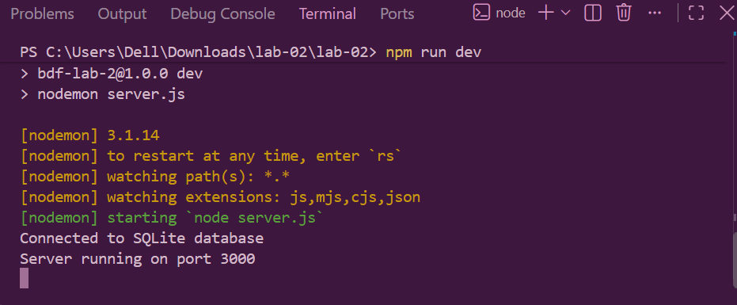
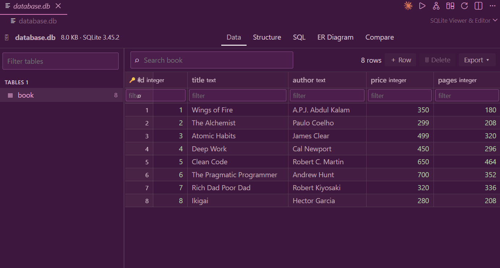
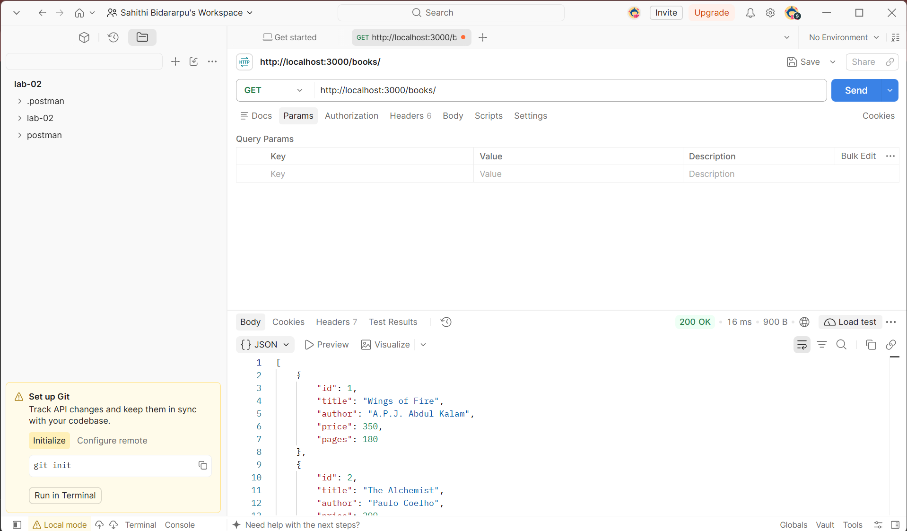
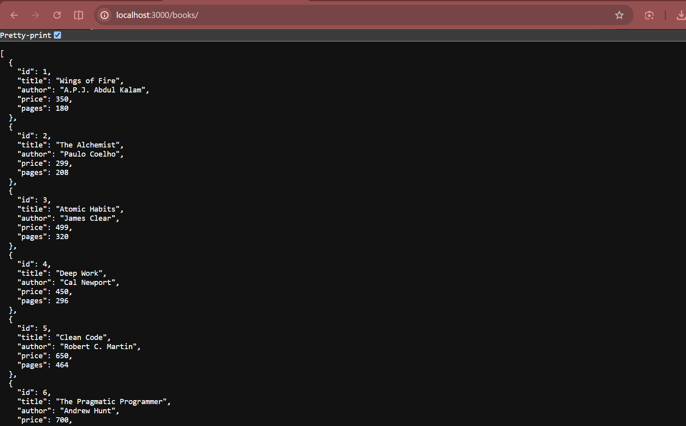
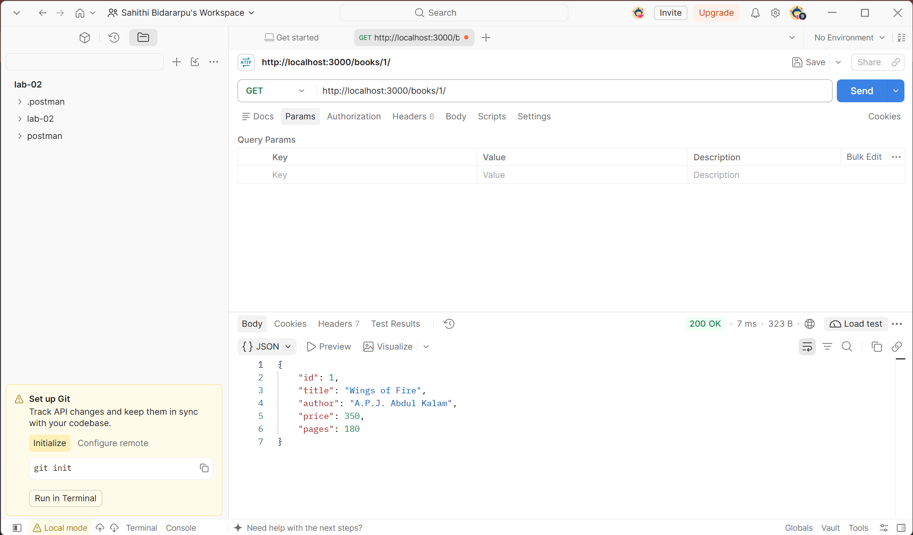
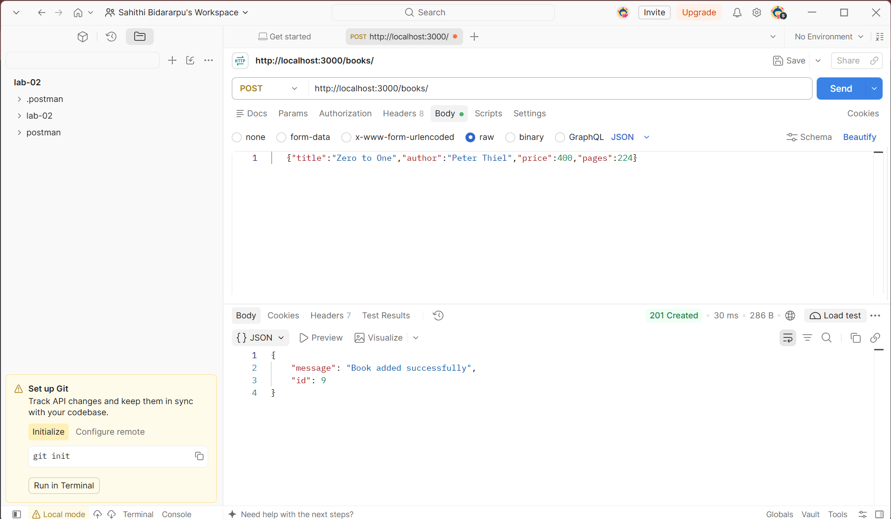
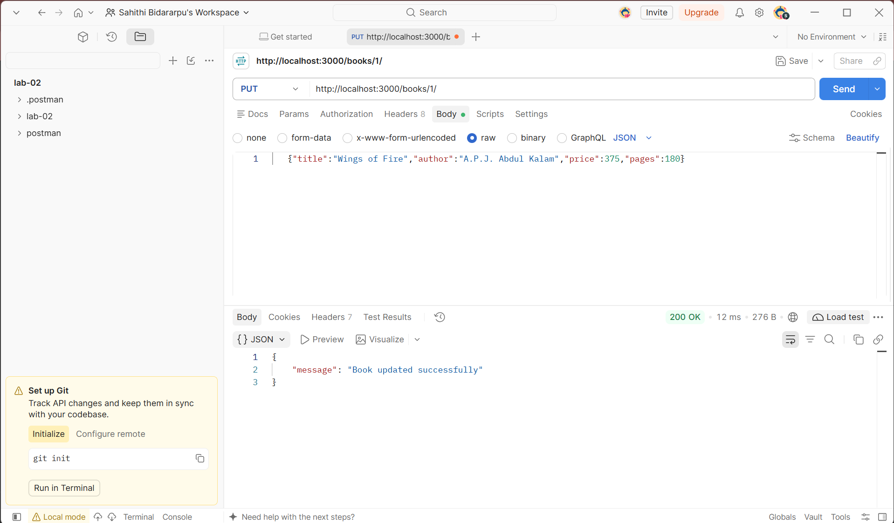
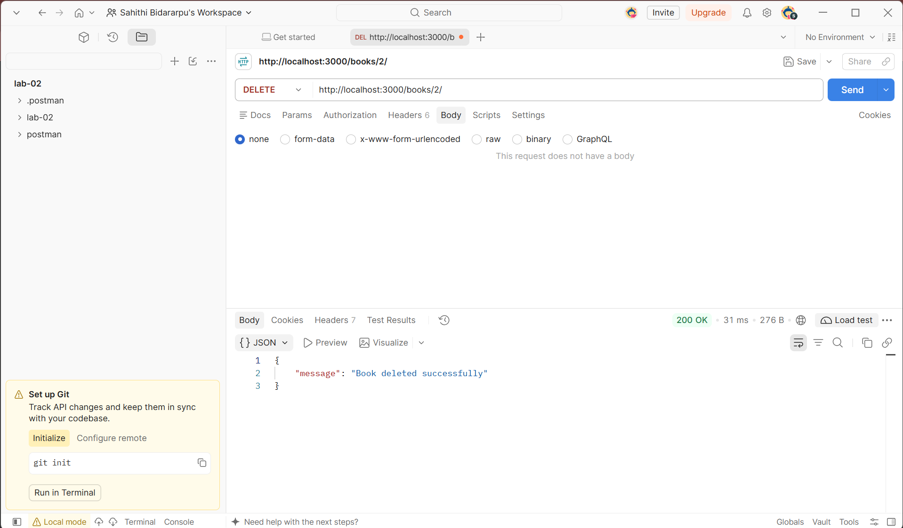
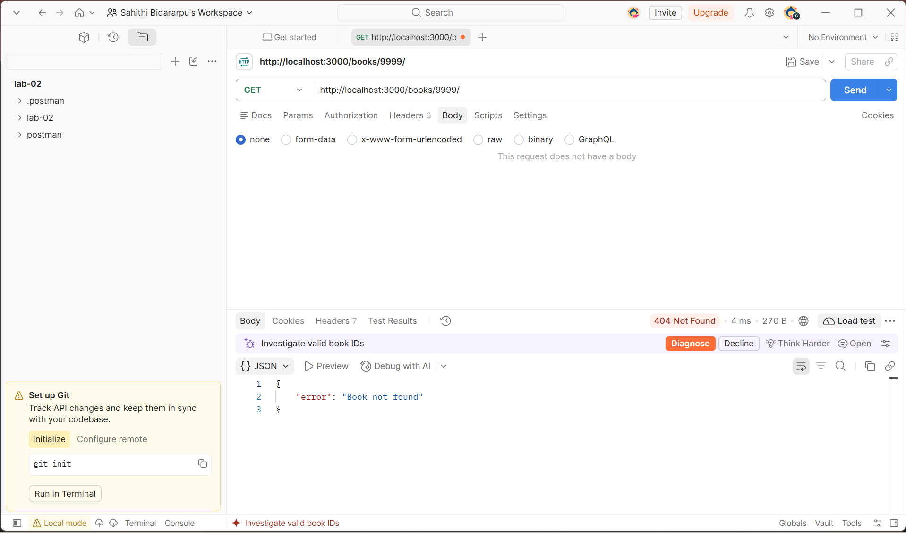
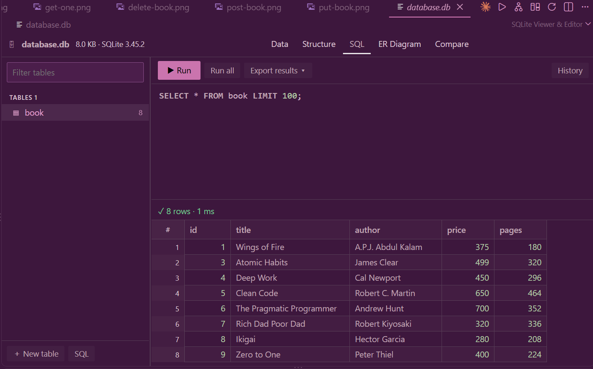

# Lab 2: SQLite database and CRUD routes

# BDF Lab 02: SQLite Database and CRUD Routes

## Student Details

| Field | Details |
|---|---|
| Name | Bidarapu Sahithi |
| Registration Number | 252U1R1034 |
| Class and Section | CSE Core 1A |
| Programme | UG, Year I, Term I |
| Institution | Aurora Higher Education and Research Academy |
| Subject | BDF |

## Project Links

| Link | URL |
|---|---|
| GitHub Repository | https://github.com/sahithibidararpu-create/BDF-Lab-2-CRUD |
| Deployed Application (Render) | https://bdf-lab-2-crud.onrender.com/books |

## Introduction

This lab builds a REST API for managing a collection of books. The server is written in Node.js with the Express framework and stores its data in a SQLite database file (`database.db`). The table structure is defined in `schema.sql`. The API supports the four basic database operations, Create, Read, Update and Delete (CRUD), through HTTP routes, and returns a 404 response when a requested book does not exist.

## Objectives

1. To create a SQLite database and define a table using SQL (`schema.sql`).
2. To connect a Node.js and Express server to the SQLite database.
3. To implement CRUD routes: GET all books, GET one book by id, POST a new book, PUT to update a book, and DELETE a book.
4. To handle errors correctly, for example returning 404 when a book is not found.
5. To test every route using Postman and the browser, and record the results as screenshots.
6. To publish the project on GitHub and deploy it on Render.


## How to run

1. Install dependencies:
   ```
   npm install
   ```
2. Start the server:
   ```
   npm start
   ```
   For auto-restart on every change use `npm run dev` (nodemon).
3. Environment variables: none are required. Optional `PORT` (default `3000`).
4. The database file `database.db` is included. To recreate it, run `sqlite3 database.db < schema.sql`.

## Endpoints

| Method | Path | Description |
|---|---|---|
| GET | /books/ | Get all books |
| GET | /books/:bookId/ | Get one book by id |
| POST | /books/ | Add a new book |
| PUT | /books/:bookId/ | Update an existing book |
| DELETE | /books/:bookId/ | Delete a book |

Request body for POST and PUT:
```json
{ "title": "Zero to One", "author": "Peter Thiel", "price": 400, "pages": 224 }
```

## Screenshots

### Server running with nodemon


### Database view in SQLite CLI (initial rows)


### GET /books/



### GET /books/:bookId/


### POST /books/


### PUT /books/:bookId/


### DELETE /books/:bookId/


### Error case (404 book not found)


### Database after POST, PUT and DELETE


## Notes

-The first Render deploy crashed with "Exited with status 1". I fixed it by setting the Node version.
A wrong URL in Postman gave a 404. I corrected the URL.
I switched from a students table to the book table the lab asked for.

## Conclusion

In this lab, a SQLite database was created and connected to an Express server, and all five CRUD routes were implemented and tested. The screenshots in the `screenshots` folder show the database before and after the changes, along with each route working. The lab showed how a backend server reads and changes persistent data through HTTP requests, and how to handle missing records with proper status codes. The finished project was then pushed to GitHub and deployed on Render.